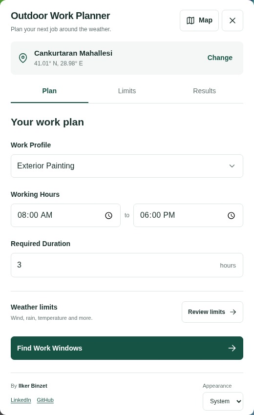
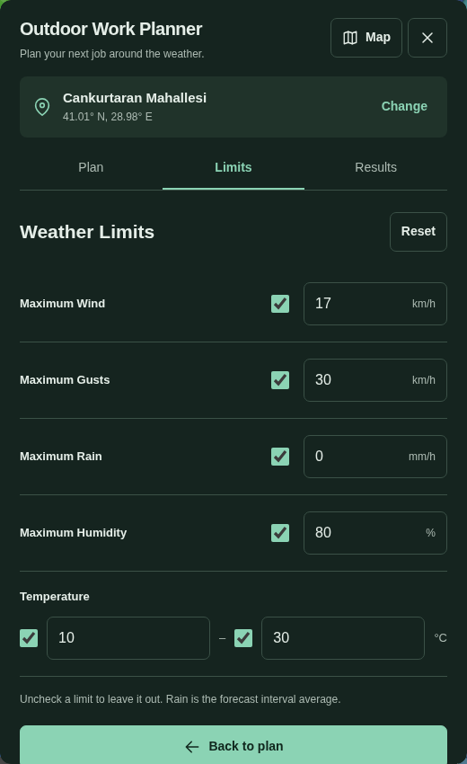

# Outdoor Work Planner

**Find weather windows for outdoor work based on your task, schedule, and weather limits.**

An English Windy.com plugin by **Ilker Binzet**.

[LinkedIn](https://ca.linkedin.com/in/binzet-me) · [GitHub](https://github.com/ilker-binzet)

## Install the published plugin

Version **0.1.0** is uploaded to Windy's official plugin host. Use this URL in Windy's plugin installation flow:

```text
https://windy-plugins.com/3164654/windy-plugin-outdoor-work-planner/0.1.0/plugin.min.js
```

[GitHub release](https://github.com/ilker-binzet/windy-plugin-outdoor-work-planner/releases/tag/v0.1.0)

The release's **Assets** section provides the compiled `plugin.min.js`, plugin metadata and a ZIP containing the published files and installation instructions. GitHub also adds separate source-code archives automatically. Windy installs the plugin from the official URL above; downloading the ZIP alone does not install it.

The plugin is configured for public review, but appearing in Windy's plugin list requires Windy's separate approval. A ready-to-post review request is available in [docs/windy-review-submission.md](docs/windy-review-submission.md).

## Features

Select a location, choose a work profile, set working hours and required duration, and find uninterrupted forecast intervals matching your limits. Painting, roofing, concrete work, general outdoor work and custom profiles are included. Edit or disable individual wind, gust, rain, temperature and humidity limits. Results explain exceeded limits and missing data. Settings are stored locally. Appearance supports **System**, **Light** and **Dark**, with a remembered manual choice.

## Screenshots

 

## Development preview

Requires Node.js 20.19+ or 22+ and npm.

```bash
npm ci
npm run dev
```

Open http://localhost:5173. This preview uses the **same planner component** as the real plugin with visibly labelled, deterministic **sample forecast data**. Its fixed Istanbul time zone and dates demonstrate the interface; changing coordinates in the preview does not retrieve weather. `?scenario=missing` and `?scenario=error` demonstrate missing data and retry behavior.

## Run inside Windy

```bash
npm ci
npm start
```

The official template builds and serves https://localhost:9999/plugin.js. Follow [Windy's development instructions](https://docs.windy-plugins.com/getting-started/debugging.html): open that local URL and trust its local development certificate, then open https://www.windy.com/developer-mode and load the plugin URL. Run the development server on the same computer as your browser, or use a reachable HTTPS address.

Select a location on the map, open the plugin from the map context menu, or enter coordinates with **Change**. The plugin follows supported land models selected in Windy; other layers use ECMWF as a fallback. The actual served model appears with the results. No separate weather API key is embedded in the plugin.

## Data and interpretation

- Uses Windy's documented `getPointForecastData` v3 response. Requests up to five days with **3-hour steps** and `interpolate: false`; actual coverage comes from the response.
- Temperature: Kelvin to Celsius. Wind and gusts: m/s to km/h. Rain: accumulated mm per three-hour segment to **average mm/h**, not instantaneous rain or probability.
- Humidity is estimated from temperature and timestamp-aligned dew point using the Magnus approximation and labelled as an estimate. Missing dew point leaves humidity unavailable.
- The final timestamp has no confirmed end boundary and is omitted. Missing intervals break continuity. Additional merged-model coverage is excluded when its interval semantics are unconfirmed.
- Every enabled limit must pass. Threshold boundaries are inclusive. Missing required values cannot pass. Results retain source resolution; clipping working hours does not imply finer forecast accuracy.
- Working hours use the location's time zone, including overnight shifts and DST. Live results exclude past time; their cutoff advances every minute and on each search.
- Profiles are editable starting points. “Matches Your Limits” describes selected weather checks. Material specifications, equipment requirements, site conditions and curing time belong to the job's own requirements.

## Checks and builds

```bash
npm test
npm run check
npm run test:e2e
npm run test:bundle
npm run build:preview
```

Install Chromium once with `npx playwright install chromium` before browser tests. Unit tests cover boundaries, gaps, missing data, normalization, local time, overnight shifts, DST, preferences, appearance and clock cleanup. Browser tests exercise actual controls, persistence, failures, mobile layout and themes.

`npm run test:windy` performs a network-dependent smoke test in the current public Windy runtime. Browser routing serves the local bundle at a virtual development URL; the test mounts it against real Windy modules, obtains live forecasts, searches, changes appearance and destroys the component. Both regular and minified bundles are tested without publishing or saving an account installation. This is separate from Windy's developer-mode installer and store approval.

`npm run build` produces `dist/plugin.js`, `dist/plugin.min.js`, `dist/plugin.json` and `dist/screenshot.jpg`. `npm run build:preview` produces a standalone demonstration in `preview-dist/`.

## License

[ISC](LICENSE). Copyright 2026 Ilker Binzet. Includes attribution to the original Windy plugin template; see [NOTICE](NOTICE). Windy service access and third-party dependencies remain governed by their own terms and licenses.

## Publication

The source code is public under ISC. The plugin is configured with `private: false` for submission to Windy's public listing; publication and Windy approval are separate steps.

1. Create a **Windy Plugins API** key at https://api.windy.com/keys.
2. Add it as a repository Actions secret named **WINDY_API_KEY** under **Settings → Secrets and variables → Actions**. Never commit the key.
3. Open **Actions → publish-plugin → Run workflow** and select `main`. The workflow checks the key before building and uploads the packaged plugin to Windy's official server.
4. Copy the installation URL from the **Publish Plugin** job log. Install and verify that exact published version.
5. Submit the plugin for Windy review through the community thread linked in the [official publication guide](https://docs.windy-plugins.com/getting-started/publishing-plugin.html). The store listing appears only after Windy approval.

Increase the plugin and package version before uploading an updated version. The workflow is manual and never uploads on ordinary pushes.

After a version has been uploaded to Windy and has a GitHub release, run **Actions → Attach published plugin files** with that version to attach the exact files served by Windy. This workflow does not republish or replace the Windy-hosted version.

## Code

- `src/plugin.svelte`: Windy integration, requests and lifecycle.
- `src/components/`: shared English planner and results.
- `src/lib/planner.ts`: pure interval evaluation.
- `src/lib/forecast.ts`: checked v3 normalization.
- `src/lib/preferences.ts`, `appearance.ts`: resilient local settings.
- `build/windy-global.js`: protects injected Windy global bindings from bundled dependency names.
- `preview/`: sample data, excluded from the actual plugin bundle.

Based on the [official Windy plugin template](https://github.com/windycom/windy-plugin-template) and its ISC-licensed development tools.
